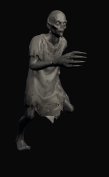
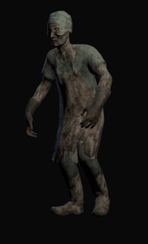
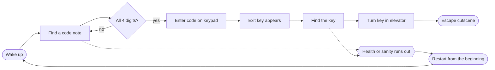
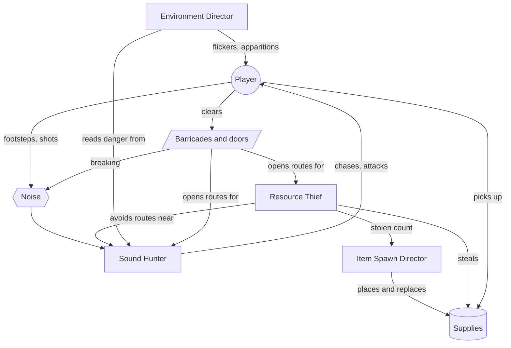
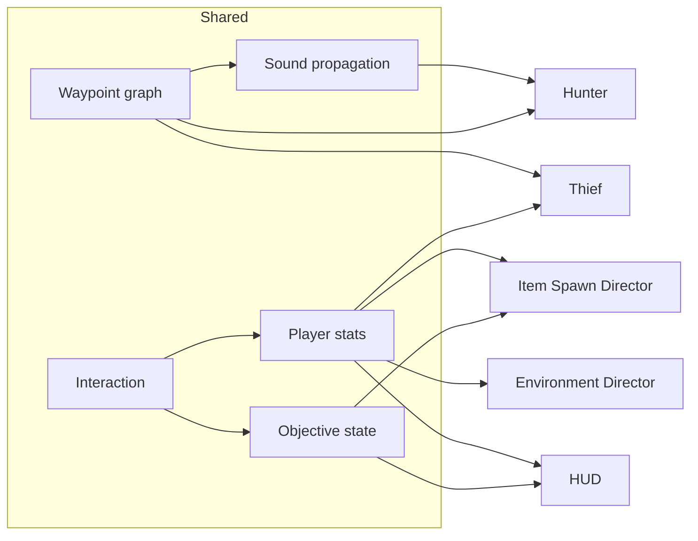

<p align="center">
  
</p>

<p align="center">
  
  
  
  
  
</p>

<p align="center">
  <a href="https://github.com/WattBhanu"></a>
  <a href="https://github.com/IT24103447"></a>
  <a href="https://github.com/IT24103581"></a>
  <a href="https://github.com/it24103457"></a>
</p>

A first-person survival horror game set in an abandoned hospital. You wake up trapped inside, and you are not alone: something hunts by sound, something else steals your supplies, and the building itself works against you. Find the elevator code, find the exit key and get out.

## Features at a glance

- **Sound Hunter:** an enemy that cannot see you. It hears footsteps, doors, barricades and gunshots through the building and comes to find out what made them.
- **Resource Thief:** an enemy that goes for the supplies you need most, carries them to its stash and vanishes, only to return later.
- **Environment Director:** an invisible agent that paces the horror with flickering lights, blackouts, whispers, phone calls and an apparition.
- **Item Spawn Director:** keeps Medkits, Ammo Boxes and Sanity Bottles spread fairly around the hospital and replaces them as they are taken or stolen.
- **Escape objective:** four code notes, an elevator keypad, an exit key and a key switch, with a cutscene for the way out.
- **Hiding and survival:** health, ammo and sanity to manage, barricades to shoot through and vents to crawl into.
- **Custom models:** supplies, the first aid shelf and the gun, modelled in Blender for this game.

---

<table align="center">
  <tr>
    <td align="center" width="22%"></td>
    <td valign="top" width="56%">

### Contents

1. [The game](#the-game)
2. [How to play](#how-to-play)
3. [Getting started](#getting-started)
4. [Team and roles](#team-and-roles)
5. [Agents](#agents)
6. [Shared systems](#shared-systems)
7. [Graphics](#graphics)
8. [Screens and UI](#screens-and-ui)
9. [Project structure and test scenes](#project-structure-and-test-scenes)
10. [Workflow](#workflow)
11. [Credits](#credits)

</td>
    <td align="center" width="22%"></td>
  </tr>
</table>

---

## The game

The only way out is the elevator. Its four-digit code is written one digit at a time on notes hidden around the hospital. Read all four, enter the code on the keypad, find the exit key that appears once the code is accepted, and turn it in the elevator's key switch.

While you search, keep your health, ammo and sanity up. The Hunter follows every noise you make, the Thief takes the supplies you were counting on, and the Environment Director chips away at your sanity with things that should not be happening.



<table>
  <tr>
    <td width="33%"></td>
    <td width="33%"></td>
    <td width="33%"></td>
  </tr>
  <tr>
    <td align="center"><sub>The hospital</sub></td>
    <td align="center"><sub>How to Play</sub></td>
    <td align="center"><sub>Main menu</sub></td>
  </tr>
</table>

---

## How to play

### Controls

| Key | Action |
|---|---|
| <kbd>W</kbd> <kbd>A</kbd> <kbd>S</kbd> <kbd>D</kbd> | Move |
| Mouse | Look around |
| Left click | Shoot |
| <kbd>R</kbd> | Reload |
| <kbd>E</kbd> | Interact: doors, items, notes, keypad |
| <kbd>Shift</kbd> (hold) | Sprint (loud) |
| <kbd>C</kbd> (hold) | Crouch (almost silent, fits through vents) |
| <kbd>Space</kbd> | Jump |
| <kbd>Esc</kbd> | Pause |

### The HUD


| Part | What it shows |
|---|---|
| Red bar | Health. Lost when the Hunter catches you. |
| Gold bar | Reserve ammo, the rounds you carry. |
| MAG | Rounds loaded in the gun, out of 6. |
| Blue bar | Sanity. Worn down by the hospital, the Thief and the Hunter. |
| Four slots | The elevator code. Each note you read fills its digit. |
| Key outline | Draws in a little with every digit, and fills in once you hold the exit key. |

### Supplies

| Supply | Restores | When the stat runs low |
|---|---|---|
| Medkit | Health | The screen edges turn red and you hear your heartbeat. At zero you die. |
| Ammo Box | Reserve ammo | An empty gun cannot stop the Thief or the Hunter. |
| Sanity Bottle | Sanity | Darkness creeps in from the edges and your head pounds. At zero you lose your mind. |

Supplies appear on beds, bedside tables, shelves and trolleys. When you take one, another appears somewhere else a little later. Supplies the Thief steals are replaced too, but more slowly.

### Enemies

<details>
<summary><b>The Thief</b></summary>

It sneaks to the supply you need most, carries it to one of its stashes (bags and baskets around the hospital) and vanishes, only to return later. Once an item reaches a stash it is gone. Just seeing the Thief chips away at your sanity. Shoot it to make it drop what it is carrying.

</details>

<details>
<summary><b>The Hunter</b></summary>

It cannot see you. It hears you. Footsteps, slamming doors, breaking barricades and gunshots all draw it in. Sprinting is loud and crouching is almost silent, but get too close and it will find you anyway. Once it is chasing you it moves faster and a few hits will kill you. Go quiet and it loses your trail. Shoot it down and it comes back a while later, somewhere out of sight.

</details>

<details>
<summary><b>The hospital itself</b></summary>

Lights flicker or die, phones ring, voices whisper and announcements play from empty speakers. Sometimes a woman appears in the room with you. Each of these wears on your sanity, and they tend to come when things are quiet.

</details>

### Barricades and hiding

Some doorways are boarded up. Shoot the planks off one at a time to get through, but breaking a barricade is loud, and once a doorway is open the Thief and the Hunter can use it too.

Some walls have low vent openings into small service spaces. Crouch to crawl in. Nothing that hunts you can follow, but stay at the back and stay quiet: right next to the opening you can still be reached and heard.

---

## Getting started

### Requirements

- **Unity 6000.6.2f1** (Unity 6.6) with the Universal Render Pipeline
- **Git** and **Git LFS** (install LFS before cloning; models, textures and audio are stored in LFS)
- **Blender**, only to edit the source models in `ArtSource/`

### Setup

```bash
git lfs install
git clone https://github.com/it24103457/Haunted-Hospital.git
cd Haunted-Hospital
git lfs pull
```

Open the folder in **Unity Hub** (Add > Add project from disk). Open `Assets/Scenes/Main/MainMenu.unity` and press Play.

The build order is `MainMenu`, `MainHospital`, `EscapeCutscene`.

<details>
<summary>Packages used</summary>

| Package | Version | Used for |
|---|---|---|
| Universal RP | 17.6.0 | Rendering, lighting, post-processing |
| AI Navigation | 2.0.14 | NavMesh movement for the Thief and the Hunter |
| Input System | 1.20.0 | Player controls |
| Timeline | 6.6.0 | Escape cutscene |
| uGUI and TextMesh Pro | 2.6.0 | Menus and HUD |

</details>

---

## Team and roles

| Member | GitHub | Agent | Project role |
|---|---|---|---|
| Wattegama | [WattBhanu](https://github.com/WattBhanu) | Resource Thief | Core Developer |
| Lalanga | [IT24103581](https://github.com/IT24103581) | Sound Hunter | Systems Engineer |
| Karunaratne | [it24103457](https://github.com/it24103457) | Item Spawn Director | Agent Controller |
| Ranasinghe | [IT24103447](https://github.com/IT24103447) | Environment Director | World Builder |

---

## Agents

Each member built one agent. Every agent has its own README with the full design, maths and testing.

<table>
  <tr>
    <td width="200"></td>
    <td>

### Resource Thief

Chooses which supply to steal with **utility scoring**: how much the player needs it, how close it is and how risky the route is. It plans with **A\*** over the shared waypoint graph, with routes near the Hunter costing more, and remembers doors and barricades it has met. It opens doors, flees to a stash when it has an item, drops the item when shot and vanishes before returning.

[Thief README](Assets/Agents/Thief/README.md)

</td>
  </tr>
  <tr>
    <td width="200"></td>
    <td>

### Sound Hunter

Hears through the building, not through the air. Every noise is **scored** by importance, loudness when it arrives and how long ago it happened, and the best few are remembered. A **state machine** moves it between Patrol, Investigate, Search, Chase and Attack. It walks with **A\*** over the waypoint graph, where closed doors cost extra and locked doors and intact barricades are blocked.

[Hunter folder](Assets/Agents/Hunter)

</td>
  </tr>
  <tr>
    <td width="200"></td>
    <td>

### Environment Director

An invisible agent that controls the hospital's pacing. It observes the player's health, sanity and surroundings, uses **fuzzy logic** to decide how much tension it wants, then **predicts and searches** short sequences of events (flicker, blackout, phone call, whisper, announcement, knock, apparition or rest) and picks the best. It replans after every event.

[Environment Director README](Assets/Agents/EnvironmentDirector/README.md)

</td>
  </tr>
  <tr>
    <td width="200"></td>
    <td>

### Item Spawn Director

Places the starting supplies as a **constraint satisfaction problem**: every item needs its own spot, in the right pool, far enough from the player. It solves this with **backtracking, MRV and forward checking**. During play it replaces taken and stolen items, keeps more of a supply out while that stat is low, and makes sure some of each type stay reachable. Its Objective Spawner places the code notes and the exit key.

[Item Spawn Director folder](Assets/Agents/ItemSpawnDirector)

</td>
  </tr>
</table>

### How the agents interact



---

## Shared systems

The agents never talk to each other directly. They share a few systems in `Assets/Scripts/`.

| System | What it does |
|---|---|
| **Waypoint graph** | 127 nodes and 207 edges laid over the hospital. Nodes know whether they are doors or barricades. Used by the Thief, the Hunter and sound. |
| **Sound propagation** | Spreads a noise through the waypoint graph with **Dijkstra's algorithm**. Loudness falls off with distance, closed doors and barricades muffle it, and walls block it completely. |
| **Player stats** | Health, sanity, ammo and the exit key, with events every agent and the HUD can listen to. |
| **Interaction** | Doors, pickups, containers (fridges, cooler boxes, first aid shelves), code notes, the keypad and the key switch. |
| **Objective state** | The code, which digits have been found, whether the code is accepted and whether the key is held. |



---

## Graphics

<details open>
<summary><b>Level and lighting</b></summary>

The hospital was blocked out from a coordinate plan, then dressed with doors, windows, vents, barricades and furniture. Lighting is built with URP: ceiling panels, dim corridors and rooms the Environment Director can flicker or black out. Low health and low sanity add screen-edge effects.

</details>

<details open>
<summary><b>Custom models</b></summary>


Medkit, Ammo Box, Sanity Bottle, first aid shelf and the syringe gun, modelled and textured in Blender. Source files are in `ArtSource/`.

</details>

<details>
<summary><b>Movement and animation</b></summary>

The Thief and the Hunter are rigged humanoids driven by Animator controllers that read each agent's state (walk, run, carry, attack, death) and blend between clips. Doors open with animation, and the Thief has its own door-opening motion. The apparition has hand-made clips for idle, body jolt and a pointing pose that aims at the player.

</details>

<details>
<summary><b>Physics</b></summary>

The player uses a character controller with gravity and jumping. Doors, barricade planks, pickups and dropped items use colliders and rigidbodies, and line-of-sight checks use raycasts.

</details>

<details>
<summary><b>Shaders and materials</b></summary>

URP Lit materials with PBR textures throughout, and transparent glass on the first aid shelves.

</details>

<details>
<summary><b>Audio</b></summary>

Spatial 3D audio for footsteps, doors, gunshots, the Hunter and every Environment Director event, plus ambient hospital sound, HUD heartbeat and headache cues, and a full soundtrack for the escape cutscene.

</details>

---

## Screens and UI

<table>
  <tr>
    <td width="50%"></td>
    <td width="50%"></td>
  </tr>
  <tr>
    <td align="center"><sub>Main menu</sub></td>
    <td align="center"><sub>Controls</sub></td>
  </tr>
</table>

- **Main menu:** Play, How to Play, Controls and Quit over a slowly drifting view of the hospital.
- **How to Play:** sections down the left, a turning model or picture for each page, and Previous and Next that carry on across sections. Pages are written in `Assets/Content/HowToPlay.txt`.
- **Controls:** a drawn keyboard and mouse with every action labelled.
- **In game:** wake-up intro, HUD, pause menu, death and sanity screens, and a win screen after the escape cutscene.

---

## Project structure and test scenes

```
Assets/
├── Agents/                 one folder per agent, owned by that member
│   ├── Thief/
│   ├── Hunter/
│   ├── EnvironmentDirector/
│   └── ItemSpawnDirector/
├── Art/                    models, textures, materials, animations, UI art
├── Audio/                  world, screens and cutscene sound
├── Content/                How to Play and Controls text
├── Prefabs/                shared prefabs, including the custom props
├── Scenes/
│   ├── Main/               MainMenu, MainHospital, EscapeCutscene
│   └── Sandbox/            test scenes
├── Scripts/                shared systems (navigation, noise, player, interaction, objectives, screens)
└── Settings/               URP settings
ArtSource/                  Blender source files, not imported by Unity
Docs/                       level layout plans and handoff notes
For_README/                 images for this README
```

<details>
<summary>Test scenes in <code>Assets/Scenes/Sandbox/</code></summary>

| Scene | Tests |
|---|---|
| `Thief_Test`, `Thief_DoorAnimation_Test` | Thief decisions, routes and door opening |
| `HunterTest`, `Hunter_model_scaling` | Hunter hearing, states and model |
| `EnvironmentDirector_Test` | Director events and planning |
| `ItemSpawner_Hospital_Test`, `ItemSpawner_Reachability_Test`, `ItemSpawner_Thief_Test` | Supply placement, reachability and stolen replacement |
| `AgentController_Test`, `Agent_Scale_Test` | Agent movement and animation |
| `Waypoint_Graph_Test` | The shared waypoint graph |
| `Apparition_Model_Test` | The apparition and her animations |
| `PlayerSandbox` | Player movement, shooting and interaction |
| `Self_Made_Props` | The custom models |
| `TestMainHospital_Gameplay`, `TestMainHospital_Screens` | Copies of the full level for gameplay and UI testing |

</details>

---

## Workflow

- `main` holds release versions, `develop` is the integration branch, and each piece of work has its own `feature/...` branch.
- Changes reach `develop` through pull requests.
- Commit messages follow `type(scope): summary`, for example `feat(thief): ...` or `feat(screens): ...`.
- Commit `.meta` files with their assets, and move or rename assets inside Unity, not in Explorer.
- Each member edits only their own agent folder and scenes. Shared scripts and `MainHospital` are changed by agreement.
- Large binary files (models, textures, audio, images) go through Git LFS.

---

## Credits

**Team:** Wattegama, Lalanga, Karunaratne and Ranasinghe.

| Asset | Source |
|---|---|
| Hospital bed and props | CobleGames |
| Hospital doors, windows and wooden planks | Hospital Stage 2 pack (`Assets/Art/ThirdParty/HospitalStage2`) |
| Furniture and props marked `_2k` | [Poly Haven](https://polyhaven.com) (CC0) |
| Apparition and stash objects | Generated with [Meshy](https://www.meshy.ai), then rigged and animated |
| Thief and Hunter character models | SOURCE TO ADD |
| Character animations | [Mixamo](https://www.mixamo.com) |
| Font | Liberation Sans (SIL Open Font License) |
| Engine and packages | Unity 6 and Unity packages |

Medkit, Ammo Box, Sanity Bottle, first aid shelf and syringe gun were modelled by the team.
