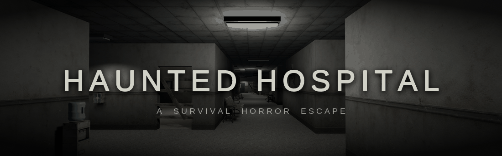
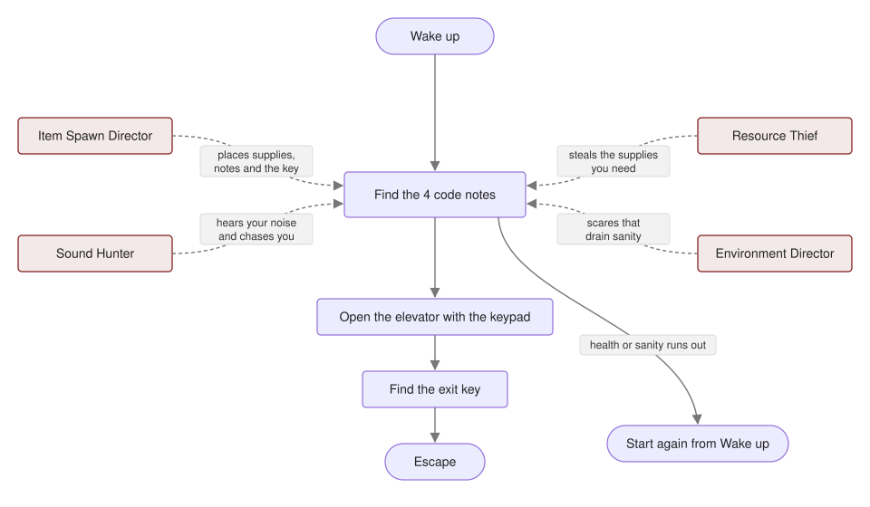
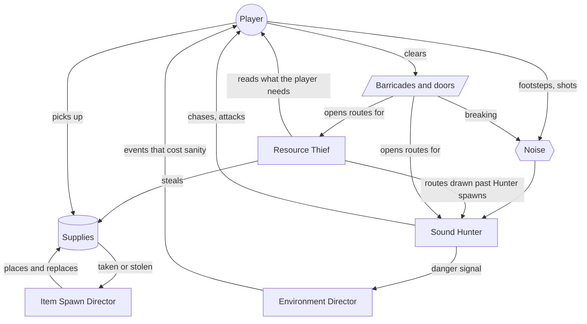
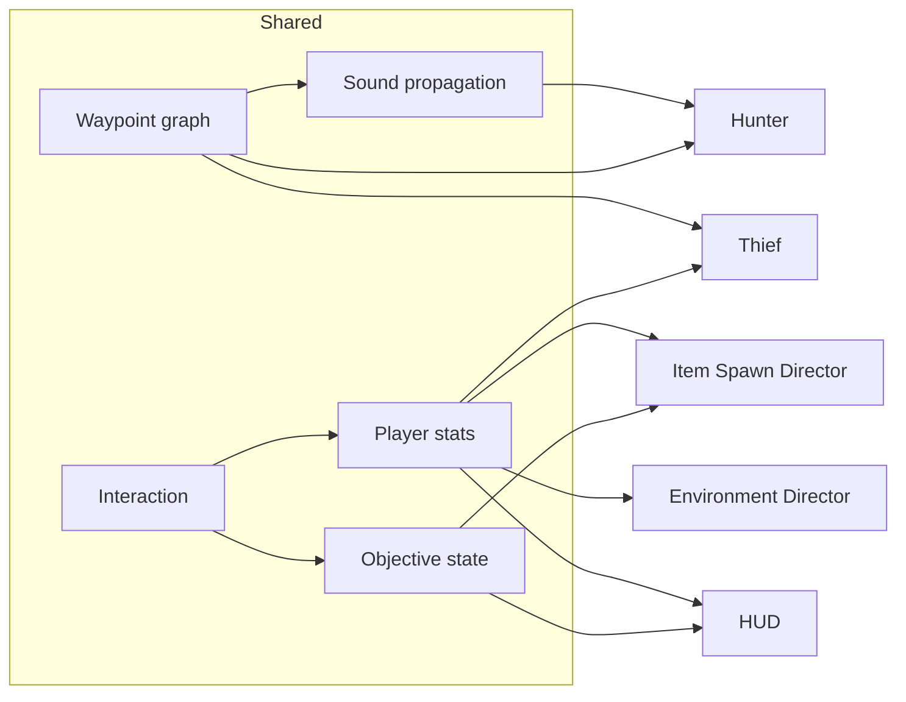

<p align="center">
  
</p>

<p align="center">
  
  
  
</p>

<p align="center">
  <a href="https://github.com/WattBhanu"></a>
  <a href="https://github.com/IT24103447"></a>
  <a href="https://github.com/IT24103581"></a>
  <a href="https://github.com/it24103457"></a>
</p>

A first-person survival horror shooter set in an abandoned hospital. You wake up trapped inside, and you are not alone: something hunts by sound, something else steals your supplies, and the building itself works against you. Find the elevator code, find the exit key and get out.

## Features at a glance

- **Sound Hunter:** an enemy that cannot see you. It hears footsteps, doors, barricades and gunshots through the building and comes to find out what made them.
- **Resource Thief:** an enemy that goes for supplies you are short of, carries them to its stash and vanishes, only to return later.
- **Environment Director:** an invisible agent that paces the horror with flickering lights, blackouts, whispers, phone calls, announcements, knocks and an apparition.
- **Item Spawn Director:** places Medkits, Ammo Boxes and Sanity Bottles around the hospital and replaces them as they are taken or stolen.
- **Escape objective:** four code notes, an elevator keypad, an exit key and a key switch, with a cutscene for the way out.
- **Hiding and survival:** health, ammo and sanity to manage, barricades to shoot through and vents to crawl into.
- **Custom models:** the supplies, the first aid shelf and the syringe gun were made for this game.

---


<div align="center">

### Contents

[The game](#the-game)<br>[How to play](#how-to-play)<br>[Getting started](#getting-started)<br>[Team and roles](#team-and-roles)<br>[Agents](#agents)<br>[Shared systems](#shared-systems)<br>[Graphics](#graphics)<br>[Screens and UI](#screens-and-ui)<br>[Project structure and test scenes](#project-structure-and-test-scenes)<br>[Workflow](#workflow)<br>[Credits](#credits)

</div>

<br clear="both">

---

## The game

The only way out is the elevator. Its four-digit code is written one digit at a time on notes hidden around the hospital. Read all four, enter the code on the keypad, find the exit key that appears once the code is accepted, and turn it in the elevator's key switch.

While you search, keep your health, ammo and sanity up. The Hunter follows every noise you make, the Thief takes the supplies you were counting on, and the Environment Director wears down your sanity with things that should not be happening.

<p align="center">
  
</p>

<table>
  <tr>
    <td width="33%"></td>
    <td width="33%"></td>
    <td width="33%"></td>
  </tr>
  <tr>
    <td align="center"><sub>The hospital</sub></td>
    <td align="center"><sub>How to Play</sub></td>
    <td align="center"><sub>Main menu</sub></td>
  </tr>
</table>

---

## How to play

### Controls

| Key | Action |
|---|---|
| <kbd>W</kbd> <kbd>A</kbd> <kbd>S</kbd> <kbd>D</kbd> | Move |
| Mouse | Look around |
| Left click | Shoot |
| <kbd>R</kbd> | Reload |
| <kbd>E</kbd> | Interact: doors, items, notes, keypad |
| <kbd>Shift</kbd> (hold) | Sprint (loud) |
| <kbd>C</kbd> (hold) | Crouch (almost silent, and lets you crawl through vents) |
| <kbd>Space</kbd> | Jump |
| <kbd>Esc</kbd> | Pause |

### The HUD


<p align="center">
  
</p>

| Part | What it shows |
|---|---|
| Red bar | Health. Lost when the Hunter catches you. |
| Gold bar | Reserve ammo, the rounds you carry. |
| MAG | Rounds loaded in the gun, out of 6. |
| Blue bar | Sanity. Worn down by the hospital, the Thief and the Hunter. |
| Four slots | The elevator code. Each note you read fills its digit. |
| Key outline | Draws in a little with every digit, and fills in once you hold the exit key. |

### Supplies

| Supply | Restores | When the stat runs low |
|---|---|---|
| Medkit | Health | The screen edges turn red and you hear your heartbeat. At zero you die. |
| Ammo Box | Reserve ammo | An empty gun cannot stop the Thief or the Hunter. |
| Sanity Bottle | Sanity | Darkness creeps in from the edges and your head pounds. At zero you lose your mind. |

Supplies appear on hospital beds, bedside tables, metal shelves and trolleys. When you take one, another appears somewhere else a little later. Supplies the Thief steals are replaced too, but more slowly.

### Enemies

<details>
<summary><b>The Thief</b></summary>

It sneaks to medkits, ammo boxes and sanity bottles, carries them to one of its stashes and vanishes, only to return later. It goes for what you need most, so do not leave supplies lying around. Once an item reaches a stash it is gone. Just seeing the Thief chips away at your sanity. Shoot it to make it drop what it is carrying.

</details>

<details>
<summary><b>The Hunter</b></summary>

It cannot see you. It hears you. Footsteps, slamming doors, breaking barricades and gunshots all draw it in. Sprinting is loud and crouching is almost silent, but get too close, even quietly, and it will find you. Once it is chasing you it moves faster, and a few hits will kill you. Go quiet and it loses your trail. Shoot it down and it comes back a while later, somewhere out of sight.

</details>

<details>
<summary><b>The hospital itself</b></summary>

Lights may flicker or die around you, and sounds come from places no one should be. A room you thought was empty might not stay that way. Each of these wears on your sanity, and they tend to come when things are quiet.

</details>

### Barricades and hiding

Some doorways are boarded up. Shoot the planks off one at a time to get through. Supplies are sometimes waiting on the other side. Breaking a barricade is loud, and once a doorway is open the Thief and the Hunter can use it too.

Some walls have low vent openings into small service spaces. Crouch to crawl in. Nothing that hunts you can follow, but get to the back and stay quiet: right next to the opening you can still be reached, and any noise you make will still be heard.

---

## Getting started

### Requirements

- **Unity 6000.6.2f1** (Unity 6.6)
- **Git** and **Git LFS** (install LFS before cloning; models, images and audio are stored in LFS)
- **Blender**, only to open the `.blend` files in `ArtSource/`

### Setup

```bash
git lfs install
git clone https://github.com/it24103457/Haunted-Hospital.git
cd Haunted-Hospital
git lfs pull
```

Open the folder in **Unity Hub** (Add > Add project from disk). Open `Assets/Scenes/Main/MainMenu.unity` and press Play.

The build order is `MainMenu`, `MainHospital`, `EscapeCutscene`.

<details>
<summary>Packages</summary>

| Package | Version |
|---|---|
| Universal RP | 17.6.0 |
| AI Navigation | 2.0.14 |
| Input System | 1.20.0 |
| Timeline | 6.6.0 |
| uGUI | 2.6.0 |

</details>

---

## Team and roles

| Member | GitHub | Agent | Project role |
|---|---|---|---|
| Wattegama B. C. | [WattBhanu](https://github.com/WattBhanu) | Resource Thief | Core Developer |
| Lalanga J. A. L. | [IT24103581](https://github.com/IT24103581) | Sound Hunter | Systems Engineer |
| Karunaratne J. M. N. V. B. | [it24103457](https://github.com/it24103457) | Item Spawn Director | Agent Controller |
| Ranasinghe A. B. | [IT24103447](https://github.com/IT24103447) | Environment Director | World Builder |

---

## Agents

Each member built one agent. The agent folders hold the full design, maths and testing.

<table>
  <tr>
    <td width="200"></td>
    <td>

### Resource Thief

Chooses which supply to steal with **utility scoring**: how far the item is from the player (weight 0.5), how much the player needs it (0.3) and how close it is to the Thief (0.2). It plans routes with **A\*** over the shared waypoint graph. Routes past the Hunter's spawn points cost half, so the Thief is drawn through the Hunter's haunts and chasing it is risky. It opens doors itself, remembers barricades it runs into and goes round them, and carries its item to a stash chosen by a **weighted random draw** (nearby stashes away from the player are likelier, and never the same one twice in a row) before vanishing and returning later. Shot dead while carrying, it drops the item.

[Thief README](Assets/Agents/Thief/README.md)

</td>
  </tr>
  <tr>
    <td width="200"></td>
    <td>

### Sound Hunter

Hears through the building, not through the air. Every noise is **scored** by importance × loudness when it arrives × e<sup>−age / time constant</sup>, and the best few are remembered. A **state machine** moves it between Patrol, Investigate, Search, Chase and Attack. It walks with **A\*** over the waypoint graph, where a closed door costs extra and locked doors, doors it just failed to open and intact barricades are blocked. When shot down it respawns out of the player's sight.

[Hunter folder](Assets/Agents/Hunter)

</td>
  </tr>
  <tr>
    <td width="200"></td>
    <td>

### Environment Director

An invisible agent that controls the hospital's pacing. It observes the player's health, sanity and surroundings, uses **fuzzy inference** to set the tension it wants, then **predicts and searches** short sequences of events (light flicker, blackout, phone call, whisper, announcement, knock, apparition or rest) and compares their heuristic scores. It carries out the first event, then observes again and replans.

[Environment Director README](Assets/Agents/EnvironmentDirector/README.md)

</td>
  </tr>
  <tr>
    <td width="200"></td>
    <td>

### Item Spawn Director

Places the starting supplies as a **constraint satisfaction problem**: every item needs its own marker, in the right pool (behind barricades or not), a minimum distance away. It solves this with **backtracking, MRV and forward checking**. During play it replaces taken and stolen items (stolen ones after a longer delay), allows fewer of a supply while the player's matching stat is low, and keeps some of each type on reachable markers. Its Objective Spawner generates the code and places the code notes and the exit key.

[Item Spawn Director folder](Assets/Agents/ItemSpawnDirector)

</td>
  </tr>
</table>

### How the agents interact



---

## Shared systems

The agents share a few systems in `Assets/Scripts/`.

| System | What it does |
|---|---|
| **Waypoint graph** | 127 nodes and 207 edges laid over the hospital, including door and barricade nodes. Used by the Thief, the Hunter and sound. |
| **Sound propagation** | Spreads a noise through the waypoint graph with **Dijkstra's algorithm**. Loudness falls off with distance, closed doors and barricades muffle it, and walls block it because they have no edges. |
| **Player stats** | Health, sanity, reserve ammo and the exit key, with events that other scripts listen to. |
| **Interaction** | Doors, pickups, fridges, cooler boxes, first aid shelves, code notes, the keypad and the key switch. |
| **Objective state** | The code, the digits found, whether the code is accepted. |



---

## Graphics

<details open>
<summary><b>Level and lighting</b></summary>

The hospital layout plans are in `Docs/`. Lighting is set up in URP, and the Environment Director can flicker or black out the lights in a room. Low health and low sanity add their own effects at the edges of the screen.

</details>

<details open>
<summary><b>Custom models</b></summary>


Medkit, Ammo Box, Sanity Bottle, first aid shelf (with a glass front) and the syringe gun.

</details>

<details>
<summary><b>Movement and animation</b></summary>

| Character | Animations |
|---|---|
| Thief | Idle, running, opening a door, grabbing an item, stashing an item, flinch, death |
| Hunter | Idle, two walks, run, look around, push, attack, hit reaction, dying |
| Apparition | Unsettling idle, body jolt, pulse pose and a pointing gesture that aims at the player |

Character animations for the Thief and the Hunter are from Mixamo.

</details>

<details>
<summary><b>Physics</b></summary>

The player moves with a character controller, with gravity, jumping, sprinting and crouching. The Environment Director's apparition only appears when an unobstructed ray connects the player to her spawn point.

</details>

<details>
<summary><b>Audio</b></summary>

Gunshots and the Environment Director's events play as spatial sound. The HUD has heartbeat and headache cues for low stats, and the escape cutscene has its own sound for the lift, the Hunter and the helicopter.

</details>

---

## Screens and UI

<table>
  <tr>
    <td width="50%"></td>
    <td width="50%"></td>
  </tr>
  <tr>
    <td align="center"><sub>Main menu</sub></td>
    <td align="center"><sub>Controls</sub></td>
  </tr>
</table>

- **Main menu:** Play, How to Play, Controls and Quit over a slowly drifting view of the hospital.
- **How to Play:** sections down the left, a turning model or picture for each page, and Previous and Next that carry on across sections. Pages are written in `Assets/Content/HowToPlay.txt`.
- **Controls:** a drawn keyboard and mouse with every action labelled.
- **In game:** wake-up intro, HUD, pause menu, death and sanity screens, escape cutscene and win screen.

---

## Project structure and test scenes

```
Assets/
├── Agents/                 one folder per agent
│   ├── Thief/
│   ├── Hunter/
│   ├── EnvironmentDirector/
│   └── ItemSpawnDirector/
├── Art/                    models, textures, materials, animations, UI art
├── Audio/                  world, screens and cutscene sound
├── Content/                How to Play and Controls text
├── Prefabs/                shared prefabs, including the custom props
├── Scenes/
│   ├── Main/               MainMenu, MainHospital, EscapeCutscene
│   └── Sandbox/            test scenes
├── Scripts/                shared systems (navigation, noise, player, interaction, objectives, screens)
└── Settings/               URP settings
ArtSource/                  Blender files for the Thief and the Hunter
Docs/                       hospital layout plans and notes
For_README/                 images for this README
```

<details>
<summary>Test scenes in <code>Assets/Scenes/Sandbox/</code></summary>

- `AgentController_Test`
- `Agent_Scale_Test`
- `Apparition_Model_Test`
- `EnvironmentDirector_Test`
- `HunterTest`
- `Hunter_model_scaling`
- `ItemSpawner_Hospital_Test`
- `ItemSpawner_Reachability_Test`
- `ItemSpawner_Thief_Test`
- `PlayerSandbox`
- `Self_Made_Props`
- `TestMainHospital_Gameplay`
- `TestMainHospital_Screens`
- `Thief_DoorAnimation_Test`
- `Thief_Test`
- `Waypoint_Graph_Test`

</details>

---

## Workflow

- Work happens on `feature/...` branches and is merged into `develop` through pull requests.
- Commit `.meta` files together with their assets, and move or rename assets inside Unity, not in Explorer.
- Each member edits their own agent folder and scenes. Changes to shared scripts and `MainHospital` are agreed with the team.
- Large binary files (models, images, audio) go through Git LFS.

---

## Credits

**Team:** Wattegama B. C., Lalanga J. A. L., Karunaratne J. M. N. V. B. and Ranasinghe A. B.

| Asset | Source |
|---|---|
| Hospital bed | CobleGames |
| Hospital doors, windows and wooden planks | Hospital Stage 2 pack |
| Thief and Hunter animations | [Mixamo](https://www.mixamo.com) |
| Sounds | [Pixabay](https://pixabay.com) |
| Font | Liberation Sans (SIL Open Font License) |
